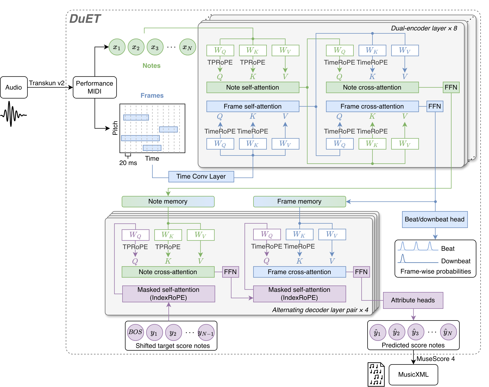

# DuET: Note--Frame Dual Encoding for Piano Performance-to-Score Transcription

<p align="center">
  <!-- Add the arXiv URL to href when available. -->
  <a href=""></a>
  <a href="https://huggingface.co/Wayne42/DuET"></a>
  <a href="https://huggingface.co/spaces/Wayne42/DuET-demo"></a>
</p>

<p align="center">
  
</p>

Official inference implementation of **DuET: Note--Frame Dual Encoding for Piano Performance-to-Score Transcription**.

DuET converts expressive piano performances into structured scores using a note encoder and a frame encoder. The two branches exchange information through bidirectional cross-attention, and a decoder alternates between their representations to predict score attributes. Joint beat and downbeat supervision supports metrical understanding, while TimeRoPE and TPRoPE encode relative performance time and pitch intervals.

Performance MIDI is supported directly, with optional piano audio transcription through Transkun v2. Outputs include MusicXML, listening MIDI, and structured note predictions.

## Installation

Use Python 3.11 or later in a dedicated environment. Install a PyTorch build appropriate for your platform, then install DuET:

```bash
git clone https://github.com/wei-zeng98/DuET.git
cd DuET
pip install .
```

For audio input, install the optional frontend and make FFmpeg available on your `PATH`:

```bash
pip install '.[audio]'
```

The audio frontend requires a compatible PyTorch and torchaudio installation. MIDI-only inference does not require Transkun or FFmpeg.

## Quick start

### Command line

Transcribe a performance MIDI file:

```bash
duet performance.mid --model Wayne42/DuET --output results/piece
```

With the audio dependencies installed:

```bash
duet piano.wav --model Wayne42/DuET --output results/audio_piece
```

The model is downloaded from Hugging Face on first use and cached locally. CUDA is selected when available; add `--device cpu` to run on CPU. Each output directory must be new. Existing results are never overwritten.

### Python

```python
from duet import DuET

model = DuET.from_pretrained("Wayne42/DuET")
report = model.transcribe("performance.mid", "results/piece")

# Optional: piano audio through Transkun v2, followed by DuET.
report = model.transcribe_audio("piano.wav", "results/audio_piece")
```

Set `device="cuda"` or `device="cpu"` in `from_pretrained` to select the inference device explicitly.

### Model access

If the Hugging Face repository requires authentication, sign in with an account that has access:

```bash
hf auth login
```

## Outputs

| File | Contents |
| --- | --- |
| `score.musicxml` | Structured notation with score timing, staff and voice assignments, meter, key signatures, and grace notes |
| `score.mid` | Listening MIDI with separate upper- and lower-staff tracks |
| `notes.json` | Raw note-aligned predictions with input-note identities |
| `report.json` | Model identity, input cleanup, window coverage, and export statistics |
| `performance.mid` | Intermediate Transkun output, for audio input only |

Open `score.musicxml` in MuseScore or another notation editor for engraving and further editing. The inference library writes MusicXML directly; MuseScore is not required for command-line transcription.

DuET assigns one score record to each retained input note and copies its pitch from the input. Long performances are processed in 32-second regions with eight seconds of preceding context. Reference scores and training caches are not required.

## Development

```bash
pip install '.[test]'
python -m unittest discover -s tests
```

Tests use generated fixtures. No training dataset or third-party performance is bundled. See [release verification](docs/VERIFICATION.md), [contribution guidelines](CONTRIBUTING.md), and [third-party notices](THIRD_PARTY_NOTICES.md).
